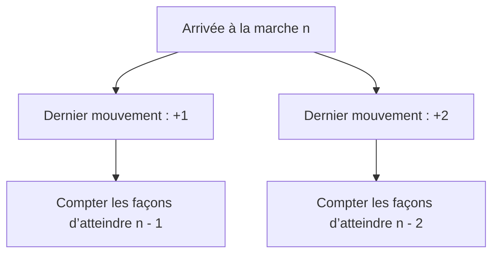
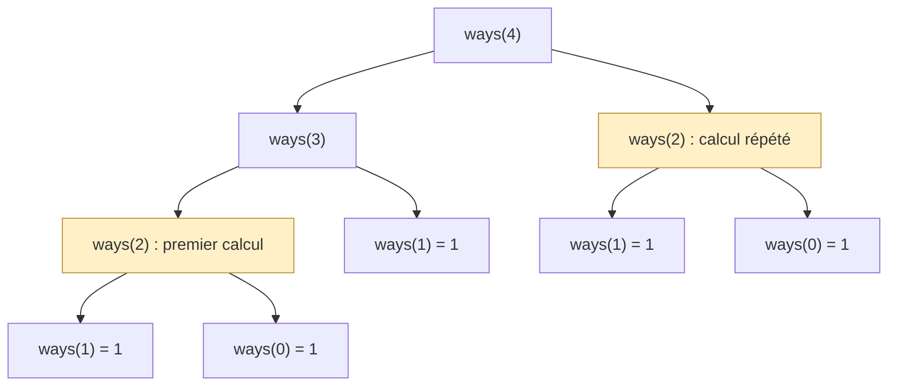
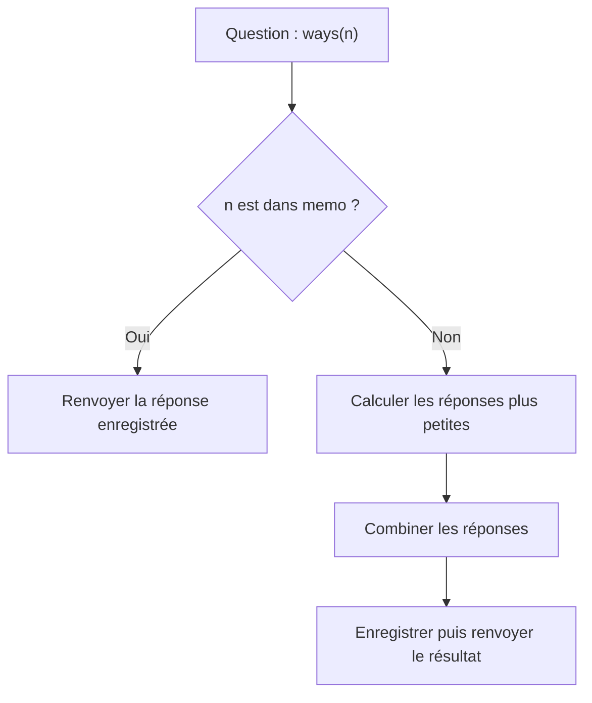
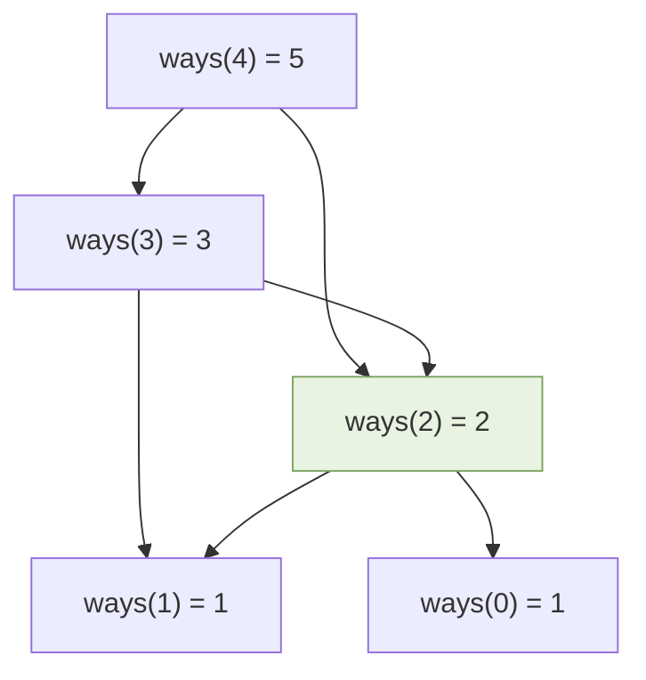
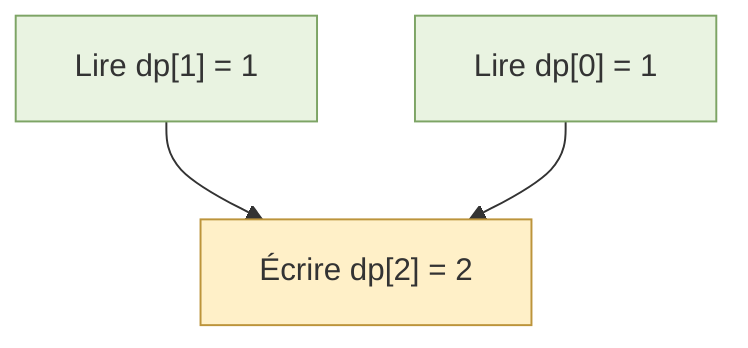
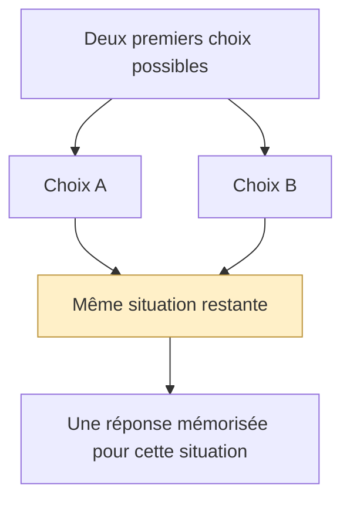
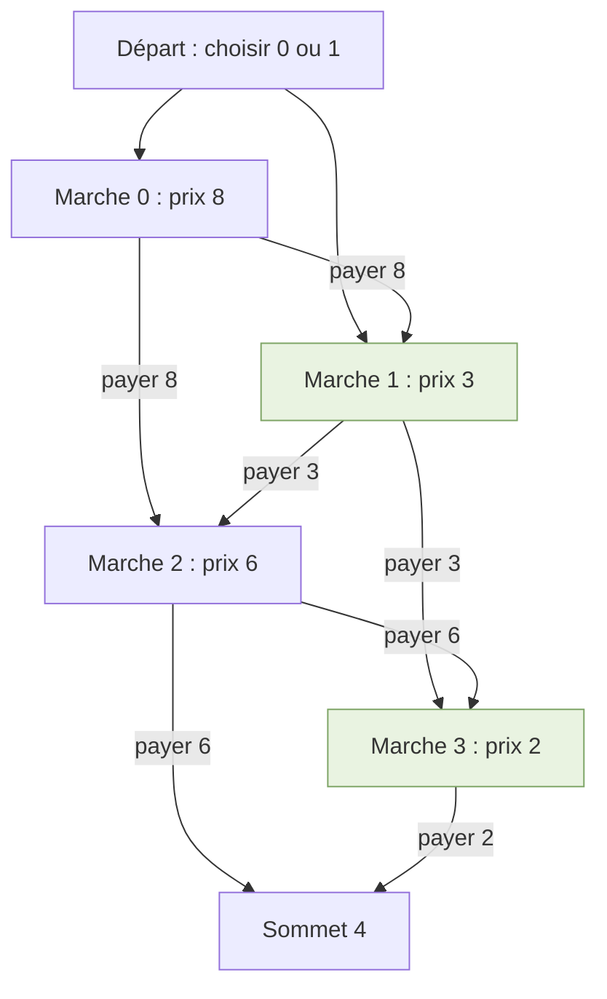
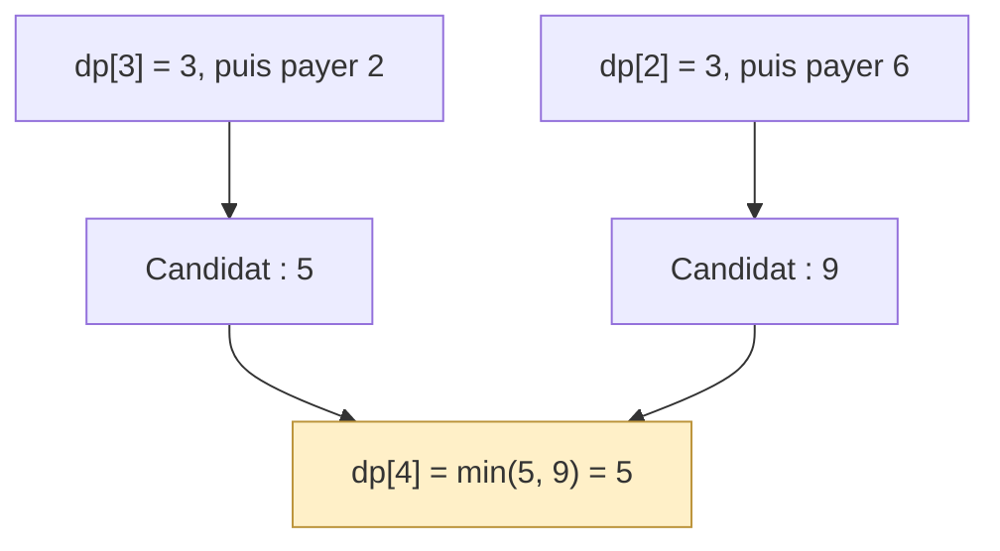
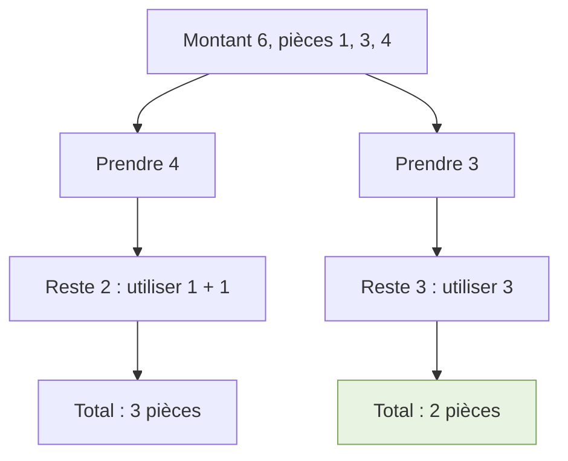
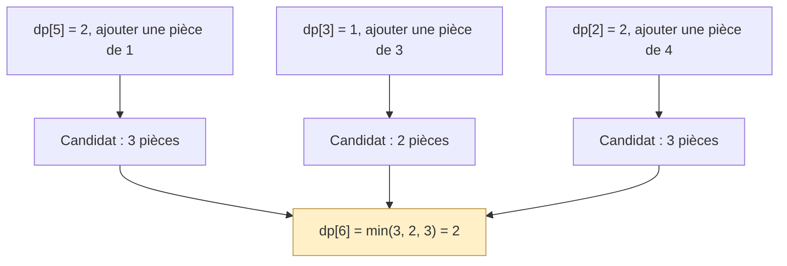

# Comprendre la programmation dynamique en Python

**Un guide progressif et illustré : récursion, top-down, bottom-up et deux exercices corrigés.**

L’objectif est de comprendre **comment trouver la solution**, avant de mémoriser du code. Nous utiliserons d’abord un même problème — monter un escalier — pour comparer les approches. Nous passerons ensuite à deux autres problèmes : un facile et un intermédiaire.

Les schémas utilisent Mermaid. Un lecteur Markdown compatible les affiche comme des illustrations. Les tableaux et les explications restent lisibles sans ce rendu.

## Sommaire

1. [De la récursion à la programmation dynamique](#1-de-la-récursion-à-la-programmation-dynamique)
2. [Top-down : partir de la question et mémoriser](#2-top-down-partir-de-la-question-et-mémoriser)
3. [Bottom-up : construire les réponses dans le bon ordre](#3-bottom-up-construire-les-réponses-dans-le-bon-ordre)
4. [Reconnaître le pattern et éviter les mauvais choix](#4-reconnaître-le-pattern-et-éviter-les-mauvais-choix)
5. [Exemple facile : coût minimal pour monter un escalier](#5-exemple-facile-coût-minimal-pour-monter-un-escalier)
6. [Exemple intermédiaire : rendre une somme avec le moins de pièces](#6-exemple-intermédiaire-rendre-une-somme-avec-le-moins-de-pièces)
7. [Fiche méthode à réutiliser](#7-fiche-méthode-à-réutiliser)

---

## 1. De la récursion à la programmation dynamique

### 1.1. Comprendre la récursion

Une fonction récursive **s’appelle elle-même pour résoudre une version plus petite du même problème**.

Elle doit avoir :

- un **cas de base** : une situation dont on connaît immédiatement la réponse ;
- une **réduction** : chaque appel rapproche le problème de ce cas de base ;
- une **combinaison** : les petites réponses permettent de produire la grande réponse.

Le cas de base permet aux appels de s’arrêter. La réduction garantit que l’on finit par l’atteindre.

**Illustration : le problème se réduit, puis les réponses remontent.**

| Phase | Ce qui se passe | Exemple avec un escalier |
|---|---|---|
| Descendre | Poser une question plus petite | Pour 4 marches, regarder 3 marches et 2 marches |
| S’arrêter | Atteindre une réponse connue | Pour 1 marche, il existe une seule façon |
| Remonter | Combiner les réponses obtenues | Ajouter les façons de terminer par un saut de 1 ou de 2 |

### 1.2. Notre problème fil conducteur : compter les façons de monter

Un escalier comporte `n` marches. À chaque mouvement, on monte **1 ou 2 marches**. Combien de suites de mouvements permettent d’atteindre exactement le sommet ?

L’ordre compte : `[1, 2]` et `[2, 1]` représentent deux façons différentes.

Pour `n = 4`, il y a cinq possibilités :

| Façon | Suite des mouvements | Total |
|---|---|---:|
| 1 | 1 + 1 + 1 + 1 | 4 |
| 2 | 1 + 1 + 2 | 4 |
| 3 | 1 + 2 + 1 | 4 |
| 4 | 2 + 1 + 1 | 4 |
| 5 | 2 + 2 | 4 |

**Astuce de départ : regarder le dernier mouvement.**

Pour arriver à la marche `n` :

- si le dernier mouvement monte de 1 marche, on venait de `n - 1` ;
- s’il monte de 2 marches, on venait de `n - 2`.



Définissons précisément notre question :

> `ways(n)` est le nombre de façons d’atteindre exactement la marche `n`.

Les deux groupes ont des derniers mouvements différents : une route ne peut donc pas appartenir aux deux groupes. On additionne leurs nombres de façons :

**`ways(n) = ways(n - 1) + ways(n - 2)`**, pour `n ≥ 2`.

Cette relation s’appelle une **récurrence**. Elle décrit la relation entre les réponses. La récursion est une manière de la programmer.

### 1.3. Définir les cas de base

| État | Réponse | Pourquoi ? |
|---|---:|---|
| `ways(0)` | 1 | Il existe une suite vide de mouvements : ne rien faire pour rester au départ |
| `ways(1)` | 1 | Un seul mouvement de 1 marche |

**Pourquoi `ways(0) = 1` et non 0 ?**

Pour atteindre la marche 2, les possibilités sont `[1, 1]` et `[2]`. La route `[2]` vient directement du départ : elle correspond à l’unique façon d’être à la marche 0, suivie d’un saut de 2.

| Origine du dernier saut | Nombre de façons avant le saut | Route obtenue |
|---|---:|---|
| Marche 1, puis +1 | `ways(1) = 1` | `[1, 1]` |
| Marche 0, puis +2 | `ways(0) = 1` | `[2]` |
| Total | 1 + 1 = 2 | Deux routes |

Dans ce guide, les fonctions d’escalier supposent un entier `n ≥ 0`. Le cas `n = 0` sert aussi d’extension pédagogique au problème LeetCode, dont l’entrée commence à 1.

### 1.4. Première solution : la récursion simple

```python
def climb_rec(n: int) -> int:
    if n <= 1:
        return 1

    return climb_rec(n - 1) + climb_rec(n - 2)
```

**Lecture du code :**

| Ligne | Rôle |
|---|---|
| `if n <= 1` | Reconnaître les deux cas de base autorisés, 0 et 1 |
| `return 1` | Fournir immédiatement leur réponse |
| `climb_rec(n - 1)` | Compter les routes dont le dernier saut vaut 1 |
| `climb_rec(n - 2)` | Compter les routes dont le dernier saut vaut 2 |
| `+` | Additionner deux groupes de routes distincts |

### 1.5. Le problème : refaire les mêmes calculs

Pour calculer `ways(4)`, la récursion produit cet arbre. Les deux nœuds colorés posent **exactement la même question** : `ways(2)`.



Pour `n = 4`, les neuf appels se répartissent ainsi :

| Question | Nombre d’appels sans mémoire |
|---|---:|
| `ways(4)` | 1 |
| `ways(3)` | 1 |
| `ways(2)` | 2 |
| `ways(1)` | 3 |
| `ways(0)` | 2 |
| **Total** | **9** |

Plus `n` augmente, plus ces répétitions deviennent coûteuses.

| Entrée | Appels de la récursion simple | Questions distinctes seulement |
|---|---:|---:|
| `n = 4` | 9 | 5 : de 0 à 4 |
| `n = 10` | 177 | 11 : de 0 à 10 |
| `n = 30` | 2 692 537 | 31 : de 0 à 30 |

Ces nombres d’appels correspondent exactement à la fonction ci-dessus. Pour les calculer sans exécuter tous les appels : `C(0) = C(1) = 1`, puis `C(n) = 1 + C(n - 1) + C(n - 2)`.

La récursion simple a ici un **temps exponentiel** : on peut le majorer par `O(2^n)`. La profondeur maximale des appels est `O(n)`, donc la pile utilise `O(n)` d’espace. Il ne faut pas confondre le nombre total d’appels avec le nombre d’appels simultanément présents dans la pile.

### 1.6. La meilleure idée : résoudre chaque état une seule fois

La **programmation dynamique**, souvent abrégée **DP**, conserve les réponses aux sous-problèmes et les réutilise.

Au lieu de recalculer `ways(2)` chaque fois qu’on le rencontre, on calcule sa réponse une fois, puis on la retrouve en mémoire.

| Sans DP | Avec DP |
|---|---|
| Chaque branche refait ses propres calculs | Plusieurs branches partagent les mêmes réponses |
| La même question peut être résolue des milliers de fois | Chaque état est calculé une fois dans nos solutions séquentielles |
| Un arbre d’appels avec des doublons | Un ensemble de dépendances entre états distincts |

Deux conditions sont particulièrement utiles :

1. **Des sous-problèmes se répètent.** Plusieurs chemins de calcul posent la même question.
2. **Leurs réponses suffisent à construire la réponse recherchée.** L’état doit contenir toutes les informations qui influencent les choix suivants.

Pour une optimisation, la deuxième idée est souvent appelée **sous-structure optimale** : une solution optimale peut être construite à partir de solutions optimales de sous-problèmes adaptés. Pour un comptage, on combine plutôt des nombres de possibilités.

La DP possède deux grandes approches : **top-down avec mémoïsation** et **bottom-up avec tabulation**.

---

## 2. Top-down : partir de la question et mémoriser

### 2.1. L’idée

**Top-down signifie : partir du problème demandé, puis descendre vers ses dépendances plus petites.**

On conserve la logique récursive, mais on ajoute un dictionnaire appelé `memo`.

Avant de résoudre une question, on vérifie : **« Ai-je déjà sa réponse ? »**



Le cache évite de recalculer un état. Il n’élimine pas les appels qui demandent une réponse déjà connue : ces appels deviennent simplement rapides.

### 2.2. Écrire la version avec dictionnaire

```python
def climb_top_down(n: int) -> int:
    memo = {0: 1, 1: 1}

    def ways(i: int) -> int:
        if i in memo:
            return memo[i]

        memo[i] = ways(i - 1) + ways(i - 2)
        return memo[i]

    return ways(n)
```

**Pourquoi une fonction à l’intérieur d’une autre ?**

La fonction extérieure reçoit `n` et crée un cache pour ce problème. La fonction intérieure résout les sous-problèmes et partage ce même cache. Un nouvel appel à la fonction extérieure crée un nouveau dictionnaire.

### 2.3. Illustration pas à pas pour `n = 4`

Au départ : `memo = {0: 1, 1: 1}`.

| Étape | Question ou action | Réponse connue ? | Effet sur la mémoire |
|---|---|---|---|
| 1 | Demander `ways(4)` | Non | Attendre `ways(3)` et `ways(2)` |
| 2 | Demander `ways(3)` | Non | Attendre `ways(2)` et `ways(1)` |
| 3 | Demander `ways(2)` | Non | Attendre `ways(1)` et `ways(0)` |
| 4 | Demander `ways(1)` puis `ways(0)` | Oui : 1 et 1 | Aucun nouveau calcul |
| 5 | Terminer `ways(2)` | 1 + 1 = 2 | Ajouter `2: 2` |
| 6 | Redemander `ways(1)` | Oui : 1 | Réutiliser la réponse |
| 7 | Terminer `ways(3)` | 2 + 1 = 3 | Ajouter `3: 3` |
| 8 | Redemander `ways(2)` | Oui : 2 | **Ne pas reconstruire son sous-arbre** |
| 9 | Terminer `ways(4)` | 3 + 2 = 5 | Ajouter `4: 5` |

Les dépendances partagent maintenant leurs états :



**Le point essentiel : deux flèches peuvent demander `ways(2)`, mais un seul résultat est enregistré pour cet état.**

### 2.4. Simplifier avec `@cache`

Python fournit `functools.cache`, qui mémorise automatiquement les résultats selon les arguments de la fonction.

```python
from functools import cache


def climb_top_down_cache(n: int) -> int:
    @cache
    def ways(i: int) -> int:
        if i <= 1:
            return 1

        return ways(i - 1) + ways(i - 2)

    return ways(n)
```

| Avec dictionnaire | Avec décorateur |
|---|---|
| `if i in memo` | Vérification automatique |
| `memo[i] = resultat` | Enregistrement automatique |
| `return memo[i]` | Réutilisation automatique |

`@cache` ne trouve pas la récurrence à votre place. Il évite de refaire le calcul d’une fonction appelée avec les mêmes arguments. Ses arguments doivent être **hachables** : un entier convient ; une liste ne convient pas directement.

La fonction interne permet ici de conserver le cache dans un seul appel du problème, au lieu de partager un cache global entre des problèmes différents.

### 2.5. Complexité et limites

| Aspect | Pour cet escalier |
|---|---|
| Nombre d’états | Au plus `n + 1` |
| Travail par état | Additionner deux réponses |
| Temps | `O(n)` |
| Cache | `O(n)` |
| Pile récursive | `O(n)` |
| Espace total | `O(n)` |

**Limite importante :** même avec un cache, une longue chaîne d’appels reste récursive. Pour de grandes entrées, Python peut atteindre sa limite de récursion. Le cache résout les calculs répétés, pas la profondeur des appels.

---

## 3. Bottom-up : construire les réponses dans le bon ordre

### 3.1. L’idée

**Bottom-up signifie : partir des réponses les plus petites, puis construire progressivement la réponse demandée.**

On remplace les appels récursifs par une boucle. Les réponses sont généralement placées dans un tableau `dp`. Cette méthode s’appelle la **tabulation**.

Le sens de parcours vient des dépendances : pour calculer `dp[i]`, il faut déjà connaître `dp[i - 1]` et `dp[i - 2]`.

| Approche | Point de départ | Mouvement du raisonnement |
|---|---|---|
| Top-down | « Je veux la réponse pour 4 » | Demander les réponses pour 3 et 2, puis descendre |
| Bottom-up | « Je connais les réponses pour 0 et 1 » | Calculer 2, puis 3, puis 4 |

Les deux méthodes utilisent **la même définition de l’état et la même récurrence**. Elles changent l’ordre et la manière d’évaluer les états.

### 3.2. Étape 1 : définir le sens d’une case

> `dp[i]` est le nombre de façons d’atteindre exactement la marche `i`.

Ne commencez pas par remplir une liste sans pouvoir expliquer cette phrase.

| Case | Question représentée |
|---|---|
| `dp[0]` | Combien de façons d’atteindre la marche 0 ? |
| `dp[1]` | Combien de façons d’atteindre la marche 1 ? |
| `dp[4]` | Combien de façons d’atteindre la marche 4 ? |

### 3.3. Étape 2 : placer les cas de base

Pour `n = 4`, on prépare cinq cases : les indices vont de 0 à 4.

| État du tableau | `dp[0]` | `dp[1]` | `dp[2]` | `dp[3]` | `dp[4]` |
|---|---:|---:|---:|---:|---:|
| Cas de base | **1** | **1** | — | — | — |

Dans les tableaux illustrés, `—` signifie « réponse pas encore calculée ». Dans le code, ces cases sont initialement allouées avec la valeur provisoire `0`.

### 3.4. Étape 3 : calculer une nouvelle réponse

Pour `i = 2` : `dp[2] = dp[1] + dp[0] = 1 + 1 = 2`.



**Les cases vertes sont lues ; la case dorée reçoit la nouvelle réponse.**

### 3.5. Étape 4 : répéter dans l’ordre des dépendances

| Étape | Calcul | `dp[0]` | `dp[1]` | `dp[2]` | `dp[3]` | `dp[4]` |
|---|---|---:|---:|---:|---:|---:|
| Initialisation | Réponses connues | 1 | 1 | — | — | — |
| `i = 2` | `1 + 1` | 1 | 1 | **2** | — | — |
| `i = 3` | `2 + 1` | 1 | 1 | 2 | **3** | — |
| `i = 4` | `3 + 2` | 1 | 1 | 2 | 3 | **5** |

À chaque ligne, la nouvelle réponse s’appuie sur des réponses déjà calculées. On renvoie `dp[4] = 5`.

### 3.6. Code complet et explication

```python
def climb_bottom_up(n: int) -> int:
    if n <= 1:
        return 1

    dp = [0] * (n + 1)
    dp[0] = dp[1] = 1

    for i in range(2, n + 1):
        dp[i] = dp[i - 1] + dp[i - 2]

    return dp[n]
```

| Ligne | Pourquoi ? |
|---|---|
| `if n <= 1` | Traiter les petites entrées avant d’écrire dans `dp[1]` |
| `[0] * (n + 1)` | Créer une case pour chaque indice de 0 à `n` |
| `dp[0] = dp[1] = 1` | Poser les réponses de départ |
| `range(2, n + 1)` | Inclure le calcul de `n`, car la borne droite de `range` est exclue |
| `dp[i - 1] + dp[i - 2]` | Réutiliser les deux dépendances |
| `return dp[n]` | Lire la case correspondant à la question initiale |

Temps : `O(n)`. Espace : `O(n)`. Il n’y a plus de pile récursive.

### 3.7. Étape 5 : optimiser la mémoire après avoir compris le tableau

Dans cet exemple, une nouvelle case dépend uniquement des deux précédentes. Il est donc possible de ne conserver que deux valeurs.

```python
def climb_optimise(n: int) -> int:
    if n <= 1:
        return 1

    deux_avant = 1
    un_avant = 1

    for i in range(2, n + 1):
        courant = deux_avant + un_avant
        deux_avant, un_avant = un_avant, courant

    return un_avant
```

**Illustration du déplacement des deux valeurs :**

| Marche à calculer | `deux_avant` avant le calcul | `un_avant` avant le calcul | `courant` | Valeurs conservées ensuite |
|---|---:|---:|---:|---|
| 2 | 1 | 1 | 2 | 1 et 2 |
| 3 | 1 | 2 | 3 | 2 et 3 |
| 4 | 2 | 3 | 5 | 3 et 5 |

L’affectation multiple évalue d’abord le côté droit. Elle évite d’écraser `un_avant` avant de l’avoir réutilisé.

Temps : `O(n)`. Espace auxiliaire : `O(1)` dans l’analyse habituelle par nombre de valeurs stockées. Pour des nombres arbitrairement grands, le coût réel des entiers augmente aussi avec leur taille.

**N’appliquez pas cette réduction de mémoire automatiquement :** d’autres problèmes doivent relire des états plus anciens ou reconstruire les choix de la solution.

### 3.8. Tester les approches

```python
for fonction in (
    climb_rec,
    climb_top_down,
    climb_top_down_cache,
    climb_bottom_up,
    climb_optimise,
):
    assert fonction(0) == 1
    assert fonction(1) == 1
    assert fonction(2) == 2
    assert fonction(4) == 5
    assert fonction(8) == 34
```

### 3.9. Comparaison pratique

| Critère | Top-down avec cache | Bottom-up |
|---|---|---|
| Point de départ | La question finale | Les cas de base |
| Mécanisme | Appels récursifs et cache | Boucles et tableau, parfois quelques variables |
| États calculés | Les états effectivement demandés | Les états prévus par les boucles |
| Ordre | Piloté par les appels | Choisi explicitement selon les dépendances |
| Risque en Python | Profondeur de récursion | Mauvais sens de parcours ou mauvaise initialisation |
| Pour comprendre | Traduire une relation récursive | Voir la construction des réponses |
| Pour de longues chaînes d’états | Attention à la pile | Souvent plus pratique |

« Top-down calcule uniquement les états demandés » ne signifie pas qu’il en calcule toujours moins. Pour notre escalier, les deux approches finissent par utiliser tous les états de 0 à `n`, pour `n ≥ 2`.

---

## 4. Reconnaître le pattern et éviter les mauvais choix

### 4.1. Les signaux de reconnaissance

Les mots de l’énoncé donnent des pistes, mais ils ne suffisent pas à prouver que la DP est adaptée.

| Ce que demande l’énoncé | Question à se poser | Exemple d’état possible |
|---|---|---|
| « Combien de façons ? » | Les mêmes situations intermédiaires reviennent-elles ? | Nombre de routes jusqu’à une position |
| « Coût minimum » | Quels choix peuvent terminer une solution ? | Coût minimum pour atteindre une position |
| « Valeur maximale » | Quel est l’effet de prendre ou ignorer un élément ? | Meilleur total sur les `i` premiers éléments |
| « Est-ce possible ? » | Plusieurs choix peuvent-ils atteindre la même situation ? | Possibilité de former une somme `s` |
| Deux chaînes ou deux séquences | Faut-il connaître une position dans chacune ? | Réponse pour les préfixes de longueurs `i` et `j` |

**Le test le plus utile : dessiner quelques choix.**

Si deux branches atteignent une situation identique, cherchez à représenter cette situation par un état réutilisable.



### 4.2. Trouver un état suffisamment précis

Un état doit contenir **tout ce qui influence les décisions restantes**, sans stocker inutilement l’historique complet.

| Problème | État utile | Pourquoi ? |
|---|---|---|
| Escalier à pas de 1 ou 2 | Position `i` | Les mouvements autorisés ne dépendent que de la position |
| Pièces réutilisables | Somme restante `a` | Les mêmes pièces restent disponibles à chaque étape |
| Sac à dos où chaque objet est utilisé une fois | Indice de l’objet et capacité restante | La capacité seule ne dit pas quels objets sont encore disponibles |
| Sous-séquence commune | Deux indices ou deux longueurs de préfixes | Il faut savoir où l’on se trouve dans chaque chaîne |

**Attention :** deux situations ayant la même somme ne sont pas forcément le même état si elles ne disposent plus des mêmes objets.

### 4.3. Choisir l’opération qui combine les réponses

| Objectif | Opération fréquente | Sens |
|---|---|---|
| Compter des possibilités distinctes | `+` | Additionner des groupes sans compter deux fois la même possibilité |
| Minimiser un coût | `min(...)` | Garder le choix le moins coûteux |
| Maximiser une valeur | `max(...)` | Garder le meilleur résultat |
| Tester une possibilité | `or` | Au moins un choix peut réussir |

Le symbole vient du sens de la question. On n’utilise pas systématiquement `dp[i - 1] + dp[i - 2]` : cette formule correspond seulement à certaines dépendances.

### 4.4. Quand un autre pattern convient mieux

| Situation | Pattern souvent plus direct | Pourquoi la DP n’est pas le premier choix |
|---|---|---|
| Trouver un élément dans un tableau trié | Recherche binaire | Une comparaison élimine la moitié des candidats |
| Trouver une paire qui donne une somme | Dictionnaire / hashing | On cherche un complément déjà rencontré |
| Plus longue sous-chaîne sans répétition | Fenêtre glissante | On maintient un bloc contigu valide en déplaçant ses bornes |
| Vérifier des parenthèses imbriquées | Pile | Le dernier élément ouvert doit être fermé en premier |
| Fusionner des intervalles | Tri puis parcours | Après le tri, une comparaison avec le dernier intervalle fusionné suffit |
| Calculer une somme simple | Boucle ou `sum` | Il n’y a pas de choix ni de sous-problèmes coûteux à réutiliser |
| Décomposer en sous-problèmes indépendants, comme le tri fusion | Diviser pour régner | Les mêmes sous-problèmes ne sont pas résolus à répétition |

Une méthode **gloutonne** peut remplacer la DP si l’on peut justifier qu’un choix local préserve toujours une solution optimale. « Cela semble être le meilleur choix » ne constitue pas une preuve. L’exemple de monnaie plus bas fournit un contre-exemple concret.

**DP n’est pas synonyme de récursion.** Une récursion qui ne répète pas de sous-problèmes peut ne tirer aucun gain d’un cache. Une DP bottom-up peut n’utiliser aucune récursion.

### 4.5. Les familles classiques qui utilisent cette technique

Les niveaux de difficulté peuvent varier selon la version du problème. Le tableau indique les idées de DP, pas une classification officielle de chaque variante.

| Famille ou algorithme | État typique | Relation entre les états |
|---|---|---|
| Fibonacci et comptage d’escaliers | Position `i` | Combiner les positions précédentes |
| Coût minimal d’un escalier | Position `i` | Comparer les coûts d’arrivée |
| House Robber | Nombre de maisons considérées | Prendre la maison ou l’ignorer |
| Rendu de monnaie, nombre minimal de pièces | Montant `a` | Essayer chaque pièce comme dernière pièce |
| Sac à dos 0/1 | Objet `i`, capacité `c` | Prendre ou ignorer l’objet courant |
| Partition en deux sommes égales | Objets considérés et somme atteignable | Conserver une possibilité ou ajouter l’objet |
| Chemins dans une grille | Cellule `(r, c)` | Utiliser les cellules précédentes autorisées |
| Plus longue sous-séquence croissante, version DP | Indice de fin `i` | Prolonger une sous-séquence se terminant plus tôt |
| Plus longue sous-séquence commune, LCS | Deux préfixes `(i, j)` | Apparier les derniers caractères ou en ignorer un |
| Distance d’édition, Levenshtein | Deux préfixes `(i, j)` | Comparer insertion, suppression et remplacement |

**Sous-chaîne et sous-séquence ne signifient pas la même chose :**

| Terme | Les éléments doivent-ils être contigus ? | Exemple dans `abcde` |
|---|---|---|
| Sous-chaîne | Oui | `bcd` |
| Sous-séquence | Non, mais l’ordre doit être conservé | `ace` |

Cette différence peut orienter vers une fenêtre glissante dans certains problèmes contigus, ou vers une DP dans certains problèmes de sous-séquences. Ce n’est pas une règle absolue.

### 4.6. Les erreurs fréquentes

| Erreur | Conséquence | Réflexe correct |
|---|---|---|
| Écrire `dp` sans définir ses cases | Récurrence incohérente | Écrire d’abord « `dp[...]` représente… » |
| Oublier un cas de base | Mauvais résultat ou récursion sans fin | Calculer les plus petites entrées à la main |
| Utiliser `0` pour un état impossible dans une minimisation | L’impossible paraît artificiellement avantageux | Utiliser `float("inf")` si cela correspond à la définition de l’état |
| Vérifier le cache avec `if memo.get(i)` | Une réponse valide de 0 ou `False` peut être traitée comme absente | Utiliser `if i in memo` |
| Parcourir le tableau dans le mauvais sens | Lire une réponse indisponible ou réutiliser un objet | Déduire l’ordre à partir des dépendances |
| Réduire trop tôt la mémoire | Perdre une valeur encore nécessaire | Commencer par une version avec tableau |
| Penser que le cache supprime la pile | Erreur de profondeur sur une grande entrée | Envisager bottom-up pour une longue chaîne d’appels |

**Illustration importante : chaque objet une fois ou réutilisation autorisée ?**

| Modèle | Exemple | Conséquence pour une DP de sommes compressée sur une seule ligne |
|---|---|---|
| Objet utilisé au plus une fois | Partition, sac à dos 0/1 | Pour chaque objet, parcourir généralement les sommes **en descendant** afin de lire les valeurs de l’étape précédente |
| Choix réutilisable | Pièces disponibles sans limite | Des transitions peuvent réutiliser des montants plus petits calculés auparavant |

Avec l’unique objet de valeur `2`, une boucle incorrecte de gauche à droite peut rendre `dp[2] = True`, puis utiliser ce nouveau résultat pour rendre `dp[4] = True`. Elle vient de réutiliser le même objet deux fois.

| Somme traitée | Lecture | Résultat incorrect si un seul objet `2` existe |
|---|---|---|
| 2 | `dp[0] = True` | `dp[2]` devient `True` |
| 4, dans le même passage | Le nouveau `dp[2] = True` | `dp[4]` devient `True` à tort |

Le sens de parcours n’est donc pas une convention esthétique : il exprime une règle du problème.

---

## 5. Exemple facile : coût minimal pour monter un escalier

**Référence : LeetCode 746, Min Cost Climbing Stairs — Easy.**

### 5.1. Comprendre le problème et illustrer les choix

On dispose d’une liste `cost`. La valeur `cost[i]` est le prix à payer quand on quitte la marche `i`. Après paiement, on avance de 1 ou 2 marches. On peut commencer directement à la marche 0 ou à la marche 1. Le sommet se trouve juste après la dernière marche.

Objectif : **atteindre le sommet avec le coût total minimal**.

Prenons `cost = [8, 3, 6, 2]`.

| Position | 0 | 1 | 2 | 3 | 4 : sommet |
|---|---:|---:|---:|---:|---|
| Prix de départ de cette position | 8 | 3 | 6 | 2 | Aucun |

Le schéma montre tous les mouvements autorisés. Le prix est celui de la marche **quittée**, pas celui de la marche d’arrivée.



Une route optimale consiste à commencer à la marche 1, aller à la marche 3, puis au sommet. Son coût vaut `3 + 2 = 5`.

### 5.2. Étape 1 : définir l’état

> `dp[i]` est le coût minimal pour **atteindre la position `i`**, avant de payer son éventuel prix de départ.

| État | Signification |
|---|---|
| `dp[2]` | Coût minimal pour atteindre la marche 2 |
| `dp[3]` | Coût minimal pour atteindre la marche 3 |
| `dp[4]` | Coût minimal pour atteindre le sommet |

La nuance « atteindre » évite de compter une marche payante deux fois.

### 5.3. Étape 2 : trouver la récurrence

Pour atteindre la position `i`, on vient de `i - 1` ou de `i - 2`.

| Origine | Coût déjà payé pour l’atteindre | Nouveau paiement | Coût total du choix |
|---|---|---|---|
| `i - 1` | `dp[i - 1]` | `cost[i - 1]` | `dp[i - 1] + cost[i - 1]` |
| `i - 2` | `dp[i - 2]` | `cost[i - 2]` | `dp[i - 2] + cost[i - 2]` |

On veut le plus petit total :

**`dp[i] = min(dp[i - 1] + cost[i - 1], dp[i - 2] + cost[i - 2])`**.

### 5.4. Étape 3 : poser les cas de base

| État | Valeur | Justification |
|---|---:|---|
| `dp[0]` | 0 | Il est permis de commencer à la marche 0 sans payer pour l’atteindre |
| `dp[1]` | 0 | Il est également permis de commencer directement à la marche 1 |

Cela ne rend pas ces marches gratuites à quitter : leur prix sera ajouté lors d’une transition.

### 5.5. Étape 4 : remplir le tableau

| Position calculée | Depuis la position précédente | Depuis deux positions avant | Valeur choisie |
|---|---|---|---:|
| 2 | `dp[1] + cost[1] = 0 + 3 = 3` | `dp[0] + cost[0] = 0 + 8 = 8` | **3** |
| 3 | `dp[2] + cost[2] = 3 + 6 = 9` | `dp[1] + cost[1] = 0 + 3 = 3` | **3** |
| 4, sommet | `dp[3] + cost[3] = 3 + 2 = 5` | `dp[2] + cost[2] = 3 + 6 = 9` | **5** |

**Illustration de la dernière mise à jour :**



Le tableau final vaut `[0, 0, 3, 3, 5]`.

### 5.6. Version bottom-up

Les entrées de cet exemple contiennent au moins deux coûts non négatifs.

```python
def cout_min_bottom_up(cost: list[int]) -> int:
    n = len(cost)
    dp = [0] * (n + 1)

    for i in range(2, n + 1):
        depuis_un = dp[i - 1] + cost[i - 1]
        depuis_deux = dp[i - 2] + cost[i - 2]
        dp[i] = min(depuis_un, depuis_deux)

    return dp[n]
```

| Détail du code | Raison |
|---|---|
| `n + 1` cases | Le sommet est la position `n`, après les indices de `cost` |
| Initialisation à 0 | Les deux états de départ sont `dp[0] = dp[1] = 0` |
| Boucle à partir de 2 | Les états 0 et 1 sont déjà connus |
| Prix `cost[i - 1]` ou `cost[i - 2]` | On paie la position de départ du mouvement |
| `return dp[n]` | On veut atteindre le sommet, pas seulement la dernière marche |

### 5.7. La même relation en top-down

```python
from functools import cache


def cout_min_top_down(cost: list[int]) -> int:
    @cache
    def atteindre(i: int) -> int:
        if i <= 1:
            return 0

        return min(
            atteindre(i - 1) + cost[i - 1],
            atteindre(i - 2) + cost[i - 2],
        )

    return atteindre(len(cost))
```

On pose d’abord la question pour le sommet ; la récursion demande les deux positions précédentes. Le cache mémorise les réponses. C’est le même état que dans le tableau, évalué dans l’autre approche.

### 5.8. Pourquoi ce pattern ? Tests et complexité

Il existe des routes alternatives et des positions intermédiaires partagées. L’information utile à réutiliser est le **coût minimum pour atteindre une position**.

Une fenêtre glissante représente un bloc contigu. Ici, on compare des routes pouvant sauter des marches : elle ne modélise pas directement le problème.

| Approche proposée | Temps | Espace |
|---|---|---|
| Bottom-up avec tableau | `O(n)` | `O(n)` |
| Top-down avec cache | `O(n)` | `O(n)`, cache et pile inclus |

La version bottom-up peut être réduite à deux valeurs précédentes, comme pour le premier escalier.

```python
for fonction in (cout_min_bottom_up, cout_min_top_down):
    assert fonction([8, 3, 6, 2]) == 5
    assert fonction([10, 15, 20]) == 15
    assert fonction([0, 0]) == 0
    assert fonction([5, 1]) == 1
    assert fonction([1, 100, 1, 1, 1, 100, 1, 1, 100, 1]) == 6
```

**Ce qui a changé par rapport au comptage :** on conserve l’idée de positions précédentes, mais on remplace l’addition des nombres de routes par une comparaison de coûts avec `min`.

---

## 6. Exemple intermédiaire : rendre une somme avec le moins de pièces

**Référence : LeetCode 322, Coin Change — Medium.**

### 6.1. Comprendre le problème

On dispose de valeurs de pièces strictement positives et d’un montant entier non négatif. Chaque valeur de pièce est disponible **sans limite**.

Renvoyer le **nombre minimal de pièces** permettant d’obtenir exactement le montant demandé, ou `-1` si cela est impossible.

Exemple : `coins = [1, 3, 4]`, `amount = 6`.

| Solution possible | Nombre de pièces |
|---|---:|
| 1 + 1 + 1 + 1 + 1 + 1 | 6 |
| 4 + 1 + 1 | 3 |
| 3 + 3 | **2** |

On cherche un minimum. On ne cherche pas le nombre de combinaisons possibles.

### 6.2. Pourquoi prendre la plus grosse pièce ne suffit pas



Le choix local `4` est plus grand, mais conduit à une solution moins bonne. Le raisonnement glouton échoue pour ces valeurs de pièces.

### 6.3. Étape 1 : définir l’état

> `dp[a]` est le nombre minimal de pièces nécessaires pour former **exactement le montant `a`**.

| État | Question représentée |
|---|---|
| `dp[0]` | Combien de pièces pour faire 0 ? |
| `dp[3]` | Combien de pièces au minimum pour faire 3 ? |
| `dp[6]` | Combien de pièces au minimum pour faire 6 ? |

### 6.4. Étape 2 : regarder la dernière pièce

Supposons qu’une pièce de valeur `coin` termine la solution du montant `a`.

Les pièces précédentes doivent former exactement `a - coin`. Il faut donc :

**`dp[a - coin] + 1` pièces**.

Le `+ 1` représente le nombre de pièces ajouté, pas la valeur monétaire ajoutée.

Pour calculer le montant 6 :

| Dernière pièce envisagée | Montant à former avant cette pièce | Meilleur nombre déjà connu | Candidat |
|---|---:|---:|---:|
| 1 | 5 | `dp[5] = 2` | 2 + 1 = 3 |
| 3 | 3 | `dp[3] = 1` | 1 + 1 = **2** |
| 4 | 2 | `dp[2] = 2` | 2 + 1 = 3 |

On prend le minimum de ces candidats :

**`dp[a] = min(dp[a - coin] + 1)` pour les pièces telles que `coin ≤ a`.**



### 6.5. Étape 3 : distinguer zéro pièce et montant impossible

| Situation | Valeur à utiliser | Pourquoi ? |
|---|---|---|
| Montant 0 | `dp[0] = 0` | Aucune pièce n’est nécessaire |
| Montant pas encore atteint | `float("inf")` | Il ne doit pas paraître meilleur qu’une vraie solution |

`∞` est un marqueur d’impossibilité ou d’absence de solution connue : `min(∞, 2)` vaut 2.

Dans cet algorithme de minimisation, on conserve `∞` pendant le calcul. On le convertit en `-1` seulement lors du résultat final. Utiliser `-1` directement dans les transitions pourrait produire un candidat artificiel de `-1 + 1 = 0`.

**Illustration :**

| Valeur examinée | Interprétation |
|---|---|
| `dp[0] = 0` | Montant atteignable avec zéro pièce |
| `dp[2] = ∞`, si seule la pièce 3 existe | Montant impossible à former |
| `∞ + 1 = ∞` | Ajouter une pièce à une situation impossible ne crée pas une solution |

### 6.6. Étape 4 : remplir les montants dans l’ordre croissant

Avec `[1, 3, 4]`, les pièces sont réutilisables. Chaque transition lit un montant plus petit, déjà calculé.

| Montant `a` | Pièce 1 | Pièce 3 | Pièce 4 | Réponse `dp[a]` |
|---|---|---|---|---:|
| 0 | — | — | — | **0** |
| 1 | `dp[0] + 1 = 1` | Trop grande | Trop grande | **1** |
| 2 | `dp[1] + 1 = 2` | Trop grande | Trop grande | **2** |
| 3 | `dp[2] + 1 = 3` | `dp[0] + 1 = 1` | Trop grande | **1** |
| 4 | `dp[3] + 1 = 2` | `dp[1] + 1 = 2` | `dp[0] + 1 = 1` | **1** |
| 5 | `dp[4] + 1 = 2` | `dp[2] + 1 = 3` | `dp[1] + 1 = 2` | **2** |
| 6 | `dp[5] + 1 = 3` | `dp[3] + 1 = 2` | `dp[2] + 1 = 3` | **2** |

Le tableau final est `[0, 1, 2, 1, 1, 2, 2]`. La réponse est `dp[6] = 2`.

### 6.7. Version bottom-up complète

```python
def monnaie_bottom_up(coins: list[int], amount: int) -> int:
    dp = [float("inf")] * (amount + 1)
    dp[0] = 0

    for a in range(1, amount + 1):
        for coin in coins:
            if coin <= a:
                candidat = dp[a - coin] + 1
                dp[a] = min(dp[a], candidat)

    return -1 if dp[amount] == float("inf") else dp[amount]
```

| Ligne | Rôle |
|---|---|
| `amount + 1` cases | Représenter les montants de 0 à `amount` |
| Valeurs initiales infinies | Ne pas inventer de solution pour un montant positif |
| `dp[0] = 0` | Créer le point de départ de toutes les solutions |
| Boucle sur `a` en ordre croissant | Garantir que `a - coin` a déjà été traité |
| `if coin <= a` | Éviter un montant négatif et un mauvais indice Python |
| `min(dp[a], candidat)` | Garder la meilleure pièce finale parmi celles essayées |
| Test final de l’infini | Traduire un montant impossible en `-1` |

### 6.8. Version top-down de la même idée

```python
from functools import cache


def monnaie_top_down(coins: list[int], amount: int) -> int:
    @cache
    def minimum(reste: int):
        if reste == 0:
            return 0

        meilleur = float("inf")

        for coin in coins:
            if coin <= reste:
                candidat = minimum(reste - coin) + 1
                meilleur = min(meilleur, candidat)

        return meilleur

    resultat = minimum(amount)
    return -1 if resultat == float("inf") else resultat
```

**Illustration des sous-problèmes réutilisés :**

| Choix depuis le montant 6 | Nouvelle question | Réutilisation possible |
|---|---|---|
| Prendre 1 | Résoudre le montant 5 | Ce calcul peut ensuite demander le montant 2 |
| Prendre 3 | Résoudre le montant 3 | Ce calcul peut aussi demander le montant 2 |
| Prendre 4 | Résoudre le montant 2 | La réponse peut déjà être en cache |

Le cache est indexé seulement par `reste`, car la liste des pièces reste identique et chaque pièce est réutilisable. Si les pièces étaient disponibles en quantités limitées, cet état ne suffirait plus forcément.

Les pièces doivent être **strictement positives**. Une pièce de valeur 0 ne réduirait pas `reste` : la récursion pourrait demander à nouveau le même état avant que son résultat soit calculé.

La version top-down est adaptée ici à la compréhension et aux petits exemples. Pour un montant élevé, notamment avec une pièce de 1, la chaîne récursive peut être trop profonde en Python. La version bottom-up évite ce problème.

### 6.9. Illustrer un cas impossible

Avec `coins = [2]` et `amount = 3` :

| Montant | Calcul | Résultat |
|---|---|---|
| 0 | Cas de base | 0 |
| 1 | Aucune pièce ne convient | `∞` |
| 2 | `dp[0] + 1` | 1 |
| 3 | `dp[1] + 1 = ∞ + 1` | `∞` |

Le montant 3 reste impossible : on renvoie `-1`.

### 6.10. Tests et complexité

```python
for fonction in (monnaie_bottom_up, monnaie_top_down):
    assert fonction([1, 3, 4], 6) == 2
    assert fonction([2], 3) == -1
    assert fonction([5], 0) == 0
    assert fonction([2, 5], 10) == 2
    assert fonction([7], 5) == -1
```

Soit `A` le montant demandé et `k` le nombre de valeurs de pièces :

| Élément | Coût |
|---|---|
| Nombre d’états | Au plus `A + 1` |
| Choix testés par état | Au plus `k` pièces |
| Temps | `O(A × k)` |
| Tableau ou cache | `O(A)` |
| Pile de la version top-down | Au plus `O(A)` pour des pièces entières positives |
| Espace total des versions proposées | `O(A)` |

Ce temps dépend de la **valeur numérique** du montant. On parle de complexité **pseudo-polynomiale** : doubler le nombre de chiffres du montant peut augmenter considérablement le nombre d’états. La DP n’est donc pas automatiquement efficace pour des montants gigantesques.

---

## 7. Fiche méthode à réutiliser

### 7.1. Les cinq phrases à écrire avant le code

| Étape | Phrase à compléter | Comptage d’escaliers | Nombre minimal de pièces |
|---|---|---|---|
| 1. État | « `dp[...]` représente… » | Les façons d’atteindre la marche `i` | Les pièces nécessaires pour former `a` |
| 2. Dernier choix | « La dernière décision peut être… » | Un saut de 1 ou de 2 | Une des pièces disponibles |
| 3. Transition | « Je combine les réponses avec… » | Une addition | Un minimum après ajout d’une pièce |
| 4. Bases | « Je connais immédiatement… » | `dp[0] = dp[1] = 1` | `dp[0] = 0` |
| 5. Ordre et résultat | « Je calcule… puis je renvoie… » | 2 à `n`, puis `dp[n]` | 1 à `A`, puis `dp[A]` ou `-1` |

**La question à garder en tête : « Quelle petite réponse me permet de construire la suivante ? »**

### 7.2. Vérifier une solution avec une petite illustration

Avant de tester une grande entrée, remplissez à la main quelques états :

| État courant | États lus | Choix comparés | Réponse écrite |
|---|---|---|---|
| Exemple : montant 6 | Montants 5, 3 et 2 | 3, 2 et 3 pièces | 2 |

Si vous ne pouvez pas justifier une seule mise à jour, revenez à la définition de l’état. Le code devrait traduire une relation déjà comprise.

### 7.3. Estimer la complexité sans deviner

Pour les solutions de ce guide :

**Temps ≈ nombre d’états × travail effectué pour chaque état.**

| Problème | États | Travail par état | Temps |
|---|---:|---|---|
| Escalier | `n + 1` | Deux lectures et une addition | `O(n)` |
| Coût minimal | `n + 1` | Comparer deux coûts | `O(n)` |
| Rendu de monnaie | `A + 1` | Essayer au plus `k` pièces | `O(A × k)` |

Pour l’espace, comptez le tableau ou le cache, **et la pile d’appels si vous utilisez la récursion**. Les analyses usuelles ci-dessus raisonnent sur les opérations et les cases stockées ; des entiers très grands peuvent augmenter le coût arithmétique réel.

### 7.4. Ce qu’il faut retenir

| Notion | Idée centrale |
|---|---|
| Récursion | Résoudre un problème en demandant des réponses plus petites |
| Problème de la récursion simple ici | Recalculer les mêmes sous-problèmes |
| Programmation dynamique | Conserver et réutiliser leurs réponses |
| Top-down | Partir du problème demandé et utiliser la récursion avec un cache |
| Bottom-up | Construire les états à partir des bases avec un ordre explicite |
| Bon réflexe | Définir l’état avant la formule ; déduire la boucle des dépendances |

## Références

Les explications, illustrations et exemples numériques de ce guide ont été rédigés pour l’apprentissage. Les intitulés et les niveaux des trois exercices de référence ont été vérifiés sur leurs pages officielles le 10 novembre 2026.

- [LeetCode 70 — Climbing Stairs, Easy](https://leetcode.com/problems/climbing-stairs/)
- [LeetCode 746 — Min Cost Climbing Stairs, Easy](https://leetcode.com/problems/min-cost-climbing-stairs/)
- [LeetCode 322 — Coin Change, Medium](https://leetcode.com/problems/coin-change/)
- [Documentation Python — functools.cache](https://docs.python.org/fr/3/library/functools.html#functools.cache)


# Exercices — Programmation dynamique

## Comment t'y prendre

1. Commence par l'exercice **🎯 à faire ensemble** : on le résout ensemble au tableau.
2. Enchaîne les exercices **✍️ à toi**, dans l'ordre (ils vont du plus facile au plus difficile).
3. Les exercices **⭐ bonus** sont pour ceux qui vont vite.
4. Pour chaque exercice, applique la méthode en 5 étapes : **Lire** les mots-clés → **écrire la solution naïve** → **choisir** le pattern → **dérouler** à la main sur l'exemple → **tester** les cas limites.
5. Si tu bloques, regarde la colonne **Piste** : elle indique la variante du pattern à utiliser.

## Les exercices

| # | Exercice | Difficulté | Rôle | Piste | Fait ? |
|---|---|---|---|---|---|
| 1 | [70. Climbing Stairs](https://leetcode.com/problems/climbing-stairs/) | 🟢 Facile | 🎯 à faire ensemble | dp[i] = dp[i-1] + dp[i-2] | [ ] |
| 2 | [746. Min Cost Climbing Stairs](https://leetcode.com/problems/min-cost-climbing-stairs/) | 🟢 Facile | ✍️ à toi | min des deux précédents | [ ] |
| 3 | [509. Fibonacci Number](https://leetcode.com/problems/fibonacci-number/) | 🟢 Facile | ✍️ à toi | dp[i] = dp[i-1] + dp[i-2] | [ ] |
| 4 | [1137. N-th Tribonacci Number](https://leetcode.com/problems/n-th-tribonacci-number/) | 🟢 Facile | ✍️ à toi | 3 cases précédentes | [ ] |
| 5 | [118. Pascal's Triangle](https://leetcode.com/problems/pascals-triangle/) | 🟢 Facile | ✍️ à toi | ligne précédente | [ ] |
| 6 | [198. House Robber](https://leetcode.com/problems/house-robber/) | 🟠 Moyen | ✍️ à toi | prendre ou sauter | [ ] |
| 7 | [322. Coin Change](https://leetcode.com/problems/coin-change/) | 🟠 Moyen | ⭐ bonus | min sur chaque pièce | [ ] |
| 8 | [300. Longest Increasing Subsequence](https://leetcode.com/problems/longest-increasing-subsequence/) | 🟠 Moyen | ⭐ bonus | dp[i] = plus longue suite qui finit en i | [ ] |
| 9 | [62. Unique Paths](https://leetcode.com/problems/unique-paths/) | 🟠 Moyen | ⭐ bonus | grille 2D | [ ] |
| 10 | [1143. Longest Common Subsequence](https://leetcode.com/problems/longest-common-subsequence/) | 🟠 Moyen | ⭐ bonus | tableau 2D | [ ] |

> 💡 Sur LeetCode, ta solution doit être écrite dans la méthode d'une `class Solution`, comme dans le code de départ proposé par le site. Tous ces exercices sont gratuits (pas besoin de compte Premium).
