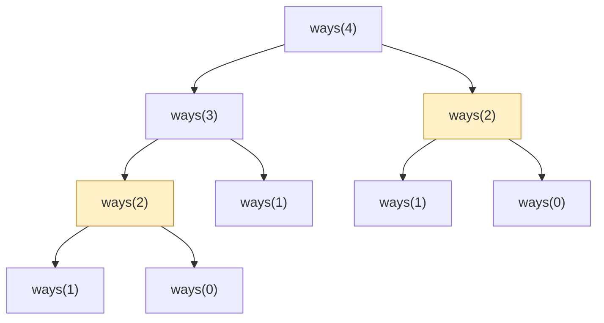
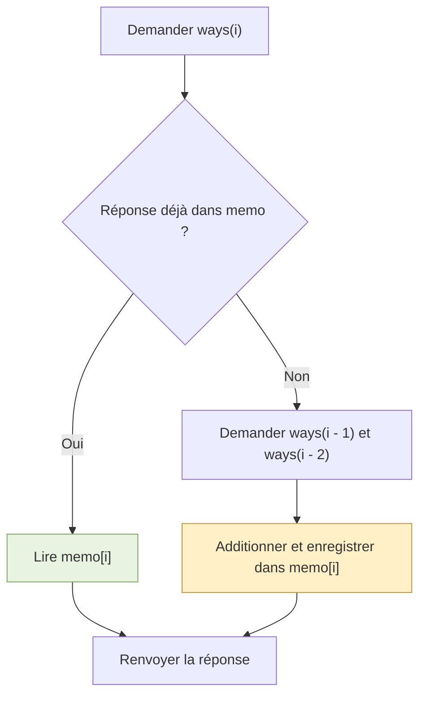
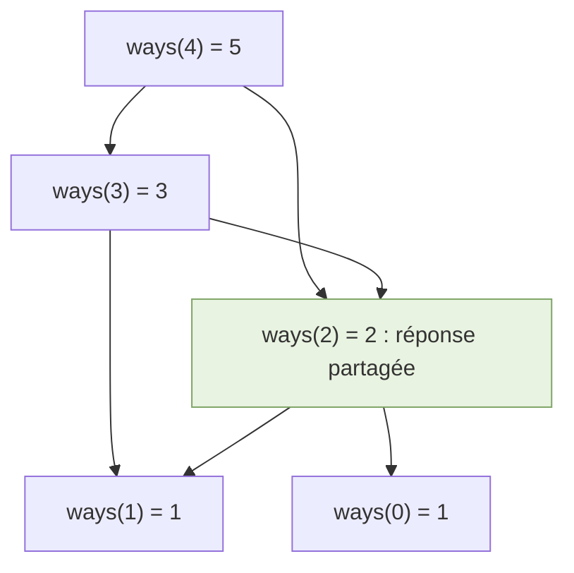
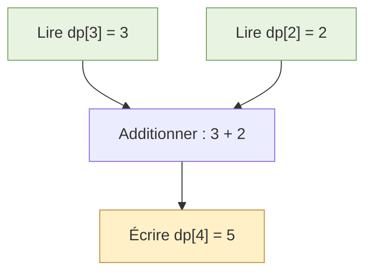
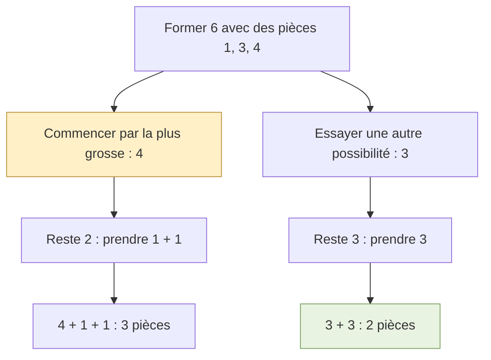
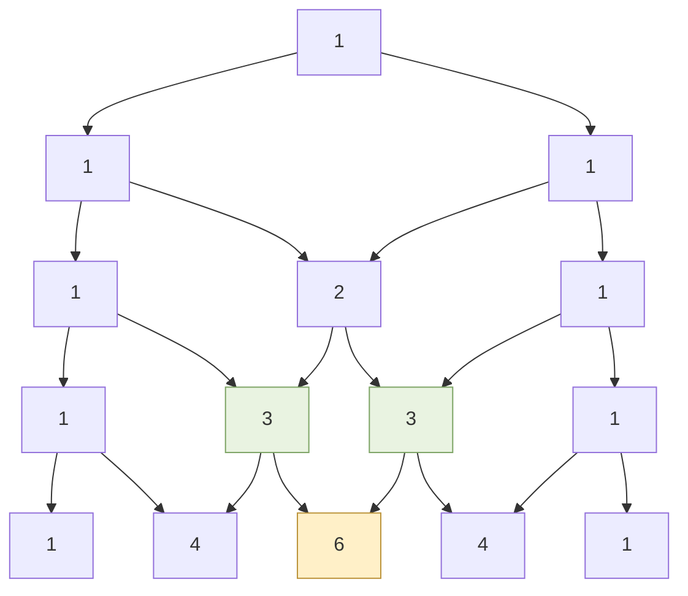
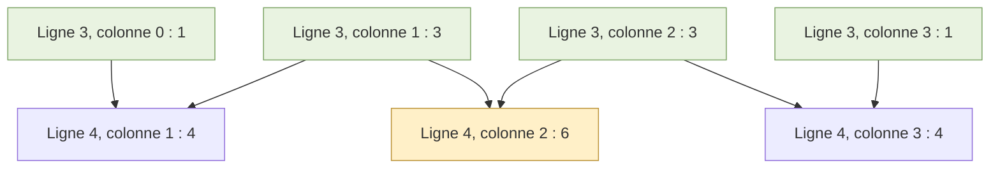
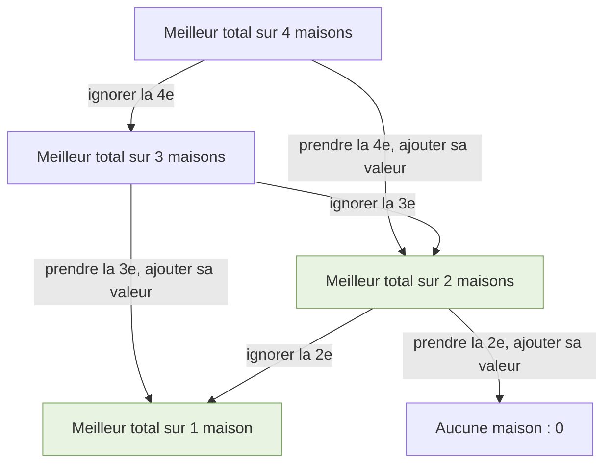
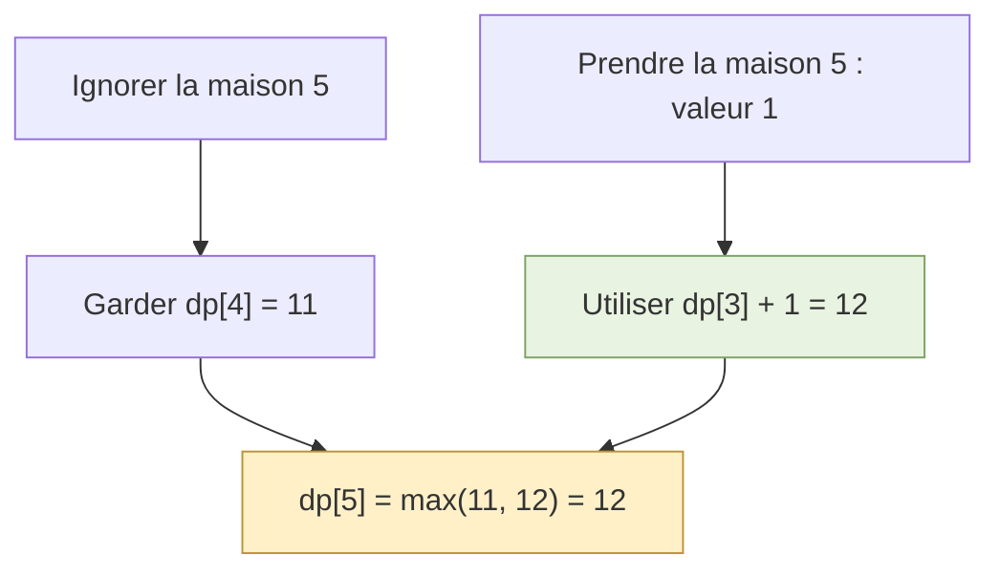
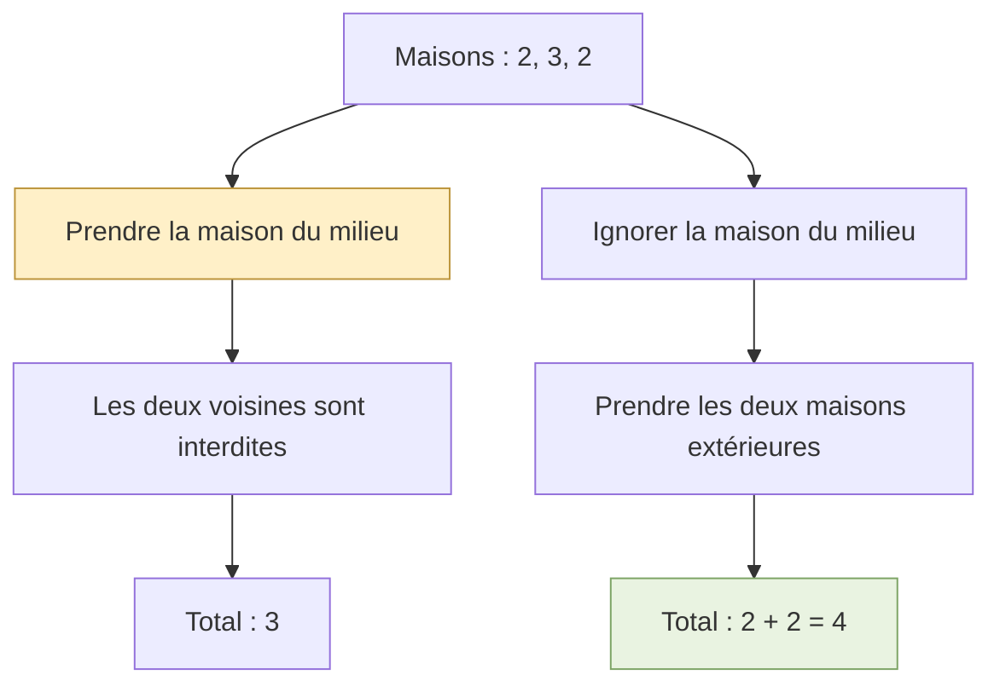

# Comprendre la programmation dynamique : un guide illustré

La **programmation dynamique (DP)** consiste à **garder les réponses aux petits problèmes pour les réutiliser**.

Nous allons suivre le même escalier pour comparer récursion, top-down et bottom-up, puis appliquer la méthode au triangle de Pascal et au choix de maisons non voisines.

**Comment lire ce guide :** regarder le schéma, suivre le calcul, puis lire le code. Les cases **vertes** représentent des réponses déjà connues ou réutilisées ; les cases **jaunes** attirent l’attention sur un calcul ou un choix.

Les schémas sont écrits en Mermaid : ils s’affichent dans un lecteur Markdown compatible. Chaque schéma est accompagné d’une explication et de valeurs concrètes.

## 1. De la récursion à la DP

### La récursion : poser une question plus petite

Une fonction récursive s’appelle elle-même. Elle réduit le problème jusqu’à un **cas de base**, dont la réponse est connue.

**Exemple :** monter un escalier de `n` marches, en avançant de 1 ou 2 marches. Combien de façons différentes permettent d’arriver en haut ? L’ordre des mouvements compte.

Appelons `ways(n)` le nombre de façons d’atteindre la marche `n`.

Pour arriver à cette marche, le dernier mouvement vient de :

| Dernier mouvement | Position précédente | Nombre de façons |
|---|---|---|
| Monter de 1 | `n - 1` | `ways(n - 1)` |
| Monter de 2 | `n - 2` | `ways(n - 2)` |

On additionne ces deux groupes :

**`ways(n) = ways(n - 1) + ways(n - 2)`**

Les réponses de départ sont :

- `ways(0) = 1` : une façon de rester au départ, sans bouger ;
- `ways(1) = 1` : un seul mouvement de 1 marche.

```python
def escalier_recursif(n: int) -> int:
    if n <= 1:
        return 1

    return escalier_recursif(n - 1) + escalier_recursif(n - 2)
```

On suppose ici que `n` est un entier positif ou nul. Le cas 0 sert de base au calcul.

**Exemple concret :** pour 3 marches, les routes sont `[1, 1, 1]`, `[1, 2]` et `[2, 1]`. Les deux premières finissent par un saut de 1, la dernière par un saut de 2. On retrouve bien `ways(3) = ways(2) + ways(1) = 2 + 1 = 3`.

### Le problème : calculer plusieurs fois la même réponse

Pour `n = 4`, la fonction demande deux fois `ways(2)`. Chaque fois, elle refait les appels nécessaires pour obtenir sa réponse.



**Les deux cases jaunes posent la même question.** Pour un grand escalier, ces répétitions deviennent très nombreuses : cette récursion a un temps exponentiel.

### La solution : conserver les réponses

Si `ways(2) = 2` a déjà été calculé, on conserve ce résultat au lieu de recommencer.

Deux approches permettent de le faire :

| Approche | Idée |
|---|---|
| **Top-down** | Partir de la question finale, utiliser la récursion et mémoriser les réponses |
| **Bottom-up** | Partir des petites réponses connues et remplir un tableau avec une boucle |

Les deux utilisent la même relation entre les réponses. Seule la manière de les calculer change.

## 2. Top-down : récursion avec mémoire

### Comment cela fonctionne

Un dictionnaire `memo` conserve les résultats déjà connus.

1. Si la réponse est dans `memo`, la renvoyer.
2. Sinon, la calculer à partir des petits problèmes.
3. La garder dans `memo`, puis la renvoyer.

**Illustration : que fait-on à chaque appel ?**



La branche verte est le raccourci : une réponse déjà calculée est lue immédiatement.

```python
def escalier_top_down(n: int) -> int:
    memo = {0: 1, 1: 1}

    def ways(i: int) -> int:
        if i in memo:
            return memo[i]

        memo[i] = ways(i - 1) + ways(i - 2)
        return memo[i]

    return ways(n)
```

La fonction intérieure `ways` partage le dictionnaire créé par la fonction extérieure.

### Illustration pour `n = 4`

On descend d’abord de 4 vers 3, puis vers 2. Les réponses pour 0 et 1 sont déjà connues. On peut alors remonter :

| Question | Calcul | Réponse conservée |
|---|---|---|
| `ways(2)` | `1 + 1` | `memo[2] = 2` |
| `ways(3)` | `2 + 1` | `memo[3] = 3` |
| `ways(2)`, redemandé depuis 4 | Lire la réponse en mémoire | 2, sans refaire le calcul |
| `ways(4)` | `3 + 2` | `memo[4] = 5` |

**Illustration : les réponses sont partagées entre les appels.**



Deux flèches demandent `ways(2)`, mais il n’existe plus qu’une réponse à calculer et à conserver pour cet état. Dans le code, `if i in memo` permet cette réutilisation.

À la fin, `memo` contient `{0: 1, 1: 1, 2: 2, 3: 3, 4: 5}`. La réponse à la question initiale est donc 5.

**Mémoïsation** signifie simplement « mémoriser les réponses d’une fonction pour les réutiliser ».

Pour cet escalier : **temps `O(n)`, espace `O(n)`**, dictionnaire et pile d’appels compris. Pour une grande entrée, la profondeur des appels peut poser problème en Python ; bottom-up évite cette limite.

## 3. Bottom-up : construire un tableau

### Comment cela fonctionne

On définit un **état**, c’est-à-dire une question précise représentée par une case :

> `dp[i]` = nombre de façons d’atteindre la marche `i`.

On connaît `dp[0]` et `dp[1]`. On calcule ensuite `dp[2]`, puis `dp[3]`, jusqu’à `dp[n]`.

### Illustration pour `n = 4`

`—` signifie « pas encore calculé ».

| Étape | Calcul | `dp[0]` | `dp[1]` | `dp[2]` | `dp[3]` | `dp[4]` |
|---|---|---:|---:|---:|---:|---:|
| Départ | Réponses connues | 1 | 1 | — | — | — |
| Marche 2 | `1 + 1` | 1 | 1 | **2** | — | — |
| Marche 3 | `2 + 1` | 1 | 1 | 2 | **3** | — |
| Marche 4 | `3 + 2` | 1 | 1 | 2 | 3 | **5** |

**Zoom sur la marche 4 : quelles cases faut-il lire ?**



Les deux cases vertes sont déjà remplies. La case jaune est la nouvelle réponse. **Chaque nouvelle case lit les deux cases précédentes** : c’est pourquoi on parcourt le tableau de gauche à droite.

```python
def escalier_bottom_up(n: int) -> int:
    if n <= 1:
        return 1

    dp = [0] * (n + 1)
    dp[0] = dp[1] = 1

    for i in range(2, n + 1):
        dp[i] = dp[i - 1] + dp[i - 2]

    return dp[n]
```

Les zéros de la liste sont seulement des valeurs provisoires avant le calcul. On crée `n + 1` cases pour inclure l’indice `n`. La boucle utilise `n + 1` comme borne, car `range` exclut sa borne finale.

**Relier le code au schéma :**

| Code | Ce que l’on voit dans l’illustration |
|---|---|
| `dp[0] = dp[1] = 1` | Les deux premières réponses sont connues |
| `range(2, n + 1)` | On avance d’une case à la suivante |
| `dp[i - 1] + dp[i - 2]` | Les deux cases vertes fournissent les valeurs |
| `dp[i] = ...` | La case jaune reçoit leur somme |
| `return dp[n]` | On lit la réponse de la marche demandée |

Pour cet escalier : **temps `O(n)`, espace `O(n)`**.

### La différence à retenir

| Top-down | Bottom-up |
|---|---|
| « Pour répondre à 4, de quelles réponses ai-je besoin ? » | « Je connais 0 et 1 : je peux construire 2, puis 3, puis 4. » |
| Récursion + mémoire | Boucle + tableau |

```python
for fonction in (escalier_recursif, escalier_top_down, escalier_bottom_up):
    assert fonction(0) == 1
    assert fonction(2) == 2
    assert fonction(4) == 5
```

## 4. Reconnaître le pattern

### Quand penser à la DP ?

Cherchez des **petites réponses à combiner et des sous-problèmes à réutiliser**. Les problèmes d’optimisation comparent des choix ; d’autres, comme le triangle de Pascal, additionnent des valeurs déjà connues.

| Ce que l’on cherche | Opération souvent utilisée | Exemple |
|---|---|---|
| Un nombre de façons | Additionner | Compter les routes d’un escalier |
| Un coût minimum | `min` | Atteindre une position au moindre coût |
| Une valeur maximale | `max` | Choisir des éléments sans prendre deux voisins |
| Savoir si c’est possible | `or` | Former une somme avec des objets |

Ces mots sont des indices, pas une preuve. Demandez-vous : **« Quelle réponse déjà calculée pourrais-je réutiliser ? »**

### Quand un autre pattern est plus simple

| Problème | Premier pattern à envisager |
|---|---|
| Chercher un élément dans une liste triée | Recherche binaire |
| Chercher deux nombres dont la somme vaut une cible | Dictionnaire pour retrouver le complément |
| Trouver la plus longue sous-chaîne sans répétition | Fenêtre glissante |
| Vérifier des parenthèses imbriquées | Pile |

La récursion seule ne suffit pas à justifier la DP : si elle ne répète pas de sous-problèmes, un cache peut être inutile.

**Attention au glouton :** choisir ce qui semble le meilleur immédiatement ne garantit pas le meilleur résultat final. Avec des pièces de 1, 3 et 4 pour former 6 :



La DP compare les conséquences des choix. L’exemple House Robber, plus bas, montre aussi pourquoi le plus grand gain immédiat peut être un mauvais choix.

### Quelques problèmes classiques de DP

| Problème | Petite réponse à conserver |
|---|---|
| Escalier / Fibonacci | La réponse pour une position |
| House Robber | Le meilleur total sur les premières maisons |
| Rendu de monnaie | Le minimum de pièces pour un montant |
| Sac à dos | Le meilleur résultat pour les objets et la capacité considérés |
| Chemins dans une grille | Le nombre de routes pour atteindre une cellule |
| Sous-séquence commune à deux chaînes | La réponse pour une position dans chaque chaîne |

### Trois pièges à éviter

- **Une case sans définition :** écrire d’abord « `dp[...]` représente… ». Sa définition doit préciser les informations qui influencent les choix restants.
- **Un mauvais ordre de calcul :** vérifier que chaque case lue possède déjà la bonne réponse.
- **Un mauvais cas de base :** tester la plus petite entrée avant les grands exemples.

**Une astuce pour écrire la formule : regarder la dernière décision.** Pour l’escalier, c’est le dernier saut ; pour la monnaie, c’est la dernière pièce. Demandez-vous ensuite : « Que fallait-il avoir résolu juste avant ? »

**Une limite à vérifier : les règles de réutilisation.** Dans le rendu de monnaie, on peut reprendre une pièce. Dans un sac à dos 0/1, chaque objet est utilisable une seule fois : une formule ou un ordre de parcours qui permet de le reprendre serait incorrect.

## 5. Exemple facile : construire le triangle de Pascal

**LeetCode 118 — Pascal’s Triangle, Easy.**

### Le problème

Construire les `num_rows` premières lignes du triangle de Pascal. Les bords valent toujours **1**. À l’intérieur, chaque nombre est la **somme des deux nombres juste au-dessus**.

Pour `num_rows = 5` :



La case jaune vaut **6**, car les deux cases vertes valent 3 et 3. Les cases sur les bords restent à 1 : elles n’ont pas deux parents à additionner.

### Étape 1 : définir une case

> `dp[r][c]` = valeur à la ligne `r`, colonne `c`.

Les indices commencent à 0. La première ligne est `r = 0` ; la cinquième est `r = 4`.

Pour une case intérieure, les deux parents sont dans la ligne précédente :

**`dp[r][c] = dp[r - 1][c - 1] + dp[r - 1][c]`**

### Étape 2 : voir les dépendances

Passons de `[1, 3, 3, 1]` à la ligne suivante. Les flèches montrent les valeurs lues pour les trois nouvelles cases intérieures.



Le même `3` peut servir à deux calculs différents. On réutilise la ligne précédente au lieu de recalculer ses valeurs.

### Étape 3 : construire ligne par ligne

On crée chaque nouvelle ligne avec des 1, puis on calcule seulement son intérieur.

| Ligne `r` | Calcul des cases intérieures | Ligne obtenue |
|---|---|---|
| 0 | Aucun intérieur | `[1]` |
| 1 | Aucun intérieur | `[1, 1]` |
| 2 | `1 + 1 = 2` | `[1, 2, 1]` |
| 3 | `1 + 2 = 3` ; `2 + 1 = 3` | `[1, 3, 3, 1]` |
| 4 | `1 + 3 = 4` ; `3 + 3 = 6` ; `3 + 1 = 4` | `[1, 4, 6, 4, 1]` |

C’est du **bottom-up** : la ligne précédente est prête avant de construire la suivante.

### Code Python

On suppose `num_rows >= 1`. La fonction renvoie toutes les lignes, pas seulement la dernière.

```python
def triangle_pascal(num_rows: int) -> list[list[int]]:
    dp = []

    for r in range(num_rows):
        ligne = [1] * (r + 1)

        for c in range(1, r):
            ligne[c] = dp[r - 1][c - 1] + dp[r - 1][c]

        dp.append(ligne)

    return dp


assert triangle_pascal(1) == [[1]]
assert triangle_pascal(3) == [[1], [1, 1], [1, 2, 1]]
assert triangle_pascal(5)[-1] == [1, 4, 6, 4, 1]
```

| Code | Rôle |
|---|---|
| `[1] * (r + 1)` | Préparer les `r + 1` cases de la ligne, avec les bords déjà corrects |
| `range(1, r)` | Traiter uniquement les colonnes intérieures ; pour les deux premières lignes, cette boucle est vide |
| `dp[r - 1][c - 1] + dp[r - 1][c]` | Additionner les deux parents déjà calculés |
| `dp.append(ligne)` | Conserver la nouvelle ligne pour les calculs suivants et pour le résultat |

**À retenir :** un état peut avoir deux indices. Il suffit de savoir précisément ce qu’ils représentent.

**Complexité :** `O(R²)` en temps et `O(R²)` en espace pour le triangle retourné, avec `R` le nombre de lignes. On construit `1 + 2 + ... + R` cases.

## 6. Exemple intermédiaire : choisir des maisons sans prendre deux voisines

**LeetCode 198 — House Robber, Medium.**

### Le problème

Chaque maison contient une somme d’argent. On veut obtenir le plus grand total, sans jamais choisir deux maisons voisines.

Exemple : `nums = [2, 7, 9, 3, 1]`.

| Maison | 1 | 2 | 3 | 4 | 5 |
|---|---:|---:|---:|---:|---:|
| Argent | 2 | 7 | 9 | 3 | 1 |
| Une sélection optimale | **Prendre** | Ignorer | **Prendre** | Ignorer | **Prendre** |

Le total vaut **2 + 9 + 1 = 12**. Les maisons choisies ne sont jamais voisines.

### Étape 1 : définir l’état

> `dp[i]` = meilleur total possible en considérant les **`i` premières maisons**.

Attention : `i` est un **nombre de maisons**. La maison actuellement examinée se trouve donc à l’indice `i - 1` de `nums`.

| État | Signification |
|---|---|
| `dp[0]` | Aucune maison considérée : total 0 |
| `dp[1]` | Seulement la première maison : total 2 |
| `dp[3]` | Meilleur total parmi les trois premières maisons : 11, en prenant 2 et 9 |

### Étape 2 : comparer « prendre » et « ignorer »

Pour la maison courante, deux choix suffisent :

| Choix | Conséquence | Total |
|---|---|---|
| L’ignorer | Garder le meilleur résultat des `i - 1` premières maisons | `dp[i - 1]` |
| La prendre | Exclure sa voisine et ajouter son argent au meilleur total des `i - 2` premières maisons | `dp[i - 2] + nums[i - 1]` |

On garde le plus grand :

**`dp[i] = max(dp[i - 1], dp[i - 2] + nums[i - 1])`**

**Illustration des questions réutilisées :**



Les cases vertes sont utilisées par plusieurs décisions. Les valeurs ajoutées sur les branches dépendent de la maison courante ; le résultat du sous-problème reste le même.

### Étape 3 : remplir le tableau

Les bases sont `dp[0] = 0` et `dp[1] = nums[0]`.

| Maisons considérées `i` | Argent courant | Ignorer : `dp[i - 1]` | Prendre : `dp[i - 2] + argent` | Meilleur total |
|---|---:|---:|---|---:|
| 0 | — | — | — | **0** |
| 1 | 2 | — | Cas de base | **2** |
| 2 | 7 | 2 | `0 + 7 = 7` | **7** |
| 3 | 9 | 7 | `2 + 9 = 11` | **11** |
| 4 | 3 | 11 | `7 + 3 = 10` | **11** |
| 5 | 1 | 11 | `11 + 1 = 12` | **12** |

**Zoom sur la dernière maison :**



Prendre la maison 5 oblige à exclure la maison 4. C’est pourquoi on lit `dp[3]`, et non `dp[4]`.

### Code Python

On suppose une liste non vide de sommes non négatives.

```python
def gain_maximal(nums: list[int]) -> int:
    n = len(nums)
    dp = [0] * (n + 1)
    dp[1] = nums[0]

    for i in range(2, n + 1):
        ignorer = dp[i - 1]
        prendre = dp[i - 2] + nums[i - 1]
        dp[i] = max(ignorer, prendre)

    return dp[n]


assert gain_maximal([2, 7, 9, 3, 1]) == 12
assert gain_maximal([2, 3, 2]) == 4
assert gain_maximal([9]) == 9
assert gain_maximal([0]) == 0
```

Le code compare deux **totaux complets**, pas simplement les valeurs de deux maisons voisines. Le tableau final est `[0, 2, 7, 11, 11, 12]`.

### Le piège : choisir seulement la plus grosse valeur

Avec `[2, 3, 2]`, prendre le 3 semble intéressant, mais bloque les deux 2.



**À retenir :** lorsqu’un choix bloque un autre choix, comparer ses conséquences avec celles de l’option « ignorer ».

**Complexité :** `O(n)` en temps et `O(n)` en espace avec le tableau proposé.

## 7. La méthode à retenir

Avant de coder, répondre à ces cinq questions :

| Question | Exemple de réponse pour l’escalier |
|---|---|
| Que représente une case ? | `dp[i]` compte les façons d’atteindre `i` |
| Quelles petites réponses faut-il lire ? | `dp[i - 1]` et `dp[i - 2]` |
| Comment les combiner ? | Les additionner |
| Quelles réponses connaît-on au départ ? | `dp[0] = dp[1] = 1` |
| Dans quel ordre calculer ? | De 2 jusqu’à `n` |

**Le réflexe essentiel : définir une petite question, garder sa réponse, puis la réutiliser.**

## Références

Énoncés et niveaux vérifiés sur les pages officielles le 10 novembre 2026. Les explications et illustrations sont des reformulations pédagogiques.

- [LeetCode 70 — Climbing Stairs](https://leetcode.com/problems/climbing-stairs/)
- [LeetCode 118 — Pascal’s Triangle](https://leetcode.com/problems/pascals-triangle/)
- [LeetCode 198 — House Robber](https://leetcode.com/problems/house-robber/)
- [LeetCode 322 — Coin Change : illustration du piège glouton](https://leetcode.com/problems/coin-change/)

# Exercices — Programmation dynamique

## Comment t'y prendre

1. Commence par l'exercice **🎯 à faire ensemble** : on le résout ensemble au tableau.
2. Enchaîne les exercices **✍️ à toi**, dans l'ordre (ils vont du plus facile au plus difficile).
3. Les exercices **⭐ bonus** sont pour ceux qui vont vite.
4. Pour chaque exercice, applique la méthode en 5 étapes : **Lire** les mots-clés → **écrire la solution naïve** → **choisir** le pattern → **dérouler** à la main sur l'exemple → **tester** les cas limites.
5. Si tu bloques, regarde la colonne **Piste** : elle indique la variante du pattern à utiliser.

## Les exercices

| # | Exercice | Difficulté | Rôle | Piste | Fait ? |
|---|---|---|---|---|---|
| 1 | [70. Climbing Stairs](https://leetcode.com/problems/climbing-stairs/) | 🟢 Facile | 🎯 à faire ensemble | dp[i] = dp[i-1] + dp[i-2] | [ ] |
| 2 | [746. Min Cost Climbing Stairs](https://leetcode.com/problems/min-cost-climbing-stairs/) | 🟢 Facile | ✍️ à toi | min des deux précédents | [ ] |
| 3 | [509. Fibonacci Number](https://leetcode.com/problems/fibonacci-number/) | 🟢 Facile | ✍️ à toi | dp[i] = dp[i-1] + dp[i-2] | [ ] |
| 4 | [1137. N-th Tribonacci Number](https://leetcode.com/problems/n-th-tribonacci-number/) | 🟢 Facile | ✍️ à toi | 3 cases précédentes | [ ] |
| 5 | [118. Pascal's Triangle](https://leetcode.com/problems/pascals-triangle/) | 🟢 Facile | ✍️ à toi | ligne précédente | [ ] |
| 6 | [198. House Robber](https://leetcode.com/problems/house-robber/) | 🟠 Moyen | ✍️ à toi | prendre ou sauter | [ ] |
| 7 | [322. Coin Change](https://leetcode.com/problems/coin-change/) | 🟠 Moyen | ⭐ bonus | min sur chaque pièce | [ ] |
| 8 | [300. Longest Increasing Subsequence](https://leetcode.com/problems/longest-increasing-subsequence/) | 🟠 Moyen | ⭐ bonus | dp[i] = plus longue suite qui finit en i | [ ] |
| 9 | [62. Unique Paths](https://leetcode.com/problems/unique-paths/) | 🟠 Moyen | ⭐ bonus | grille 2D | [ ] |
| 10 | [1143. Longest Common Subsequence](https://leetcode.com/problems/longest-common-subsequence/) | 🟠 Moyen | ⭐ bonus | tableau 2D | [ ] |

> 💡 Sur LeetCode, ta solution doit être écrite dans la méthode d'une `class Solution`, comme dans le code de départ proposé par le site. Tous ces exercices sont gratuits (pas besoin de compte Premium).
